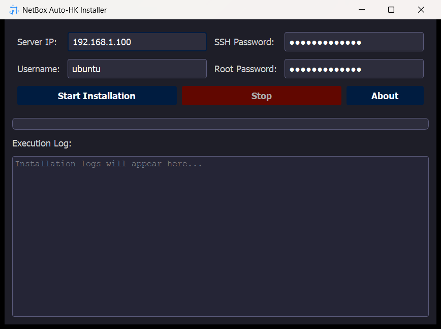
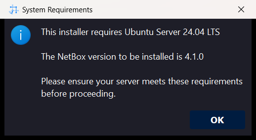

<h1 align="center">NetBox Auto-HK Installer</h1>

<p align="center"><b>Install NetBox on an Ubuntu server over SSH with one click</b></p>

<p align="center">
  
  
  
  <a href="https://github.com/alisadhk/netbox-auto-hk-installer/releases/latest"></a>
</p>

---

## Overview
A PyQt5 wizard that connects to a fresh Ubuntu server over SSH (paramiko) and installs NetBox: packages, PostgreSQL database, Redis, application settings with a generated secret key, services and the web proxy.

## Features
- Fully automated NetBox installation
- Random secret key and database password generation
- Live execution log with progress bar
- Stop button and installation summary
- Installs PostgreSQL, Redis and the Python environment automatically
- Creates the database and user with a random password
- Generates the NetBox secret key for you

## How it works
- The installer connects over SSH and runs pt update plus the required packages (Python, PostgreSQL, Redis, build tools).
- It creates the 
etbox database and user, downloads NetBox, prepares a Python virtual environment and writes the configuration with a generated secret key.
- It runs the migrations, enables the services and publishes the web interface over HTTPS.
- The log ends with **Installation Complete** and the address to open.

## Requirements
- Fresh Ubuntu server with SSH and sudo/root access.
- Outbound Internet on the server (apt and GitHub).
- Windows 10/11 for the installer GUI.

## Screenshots
<p align="center"></p>
<p align="center"></p>

## Download and install
### Option A - Ready-to-run download (recommended)
1. Open the **[Releases page](https://github.com/alisadhk/netbox-auto-hk-installer/releases/latest)**.
2. Download the file(s) listed under **Assets**:

| File | Size |
|---|---|
| `NetBox-Auto-HK-Installer.exe` | 41.7 MB |

3. Run it. 

### Option B - Run from source
Requirements: Windows 10/11 and Python 3.10+.

```bash
git clone https://github.com/alisadhk/netbox-auto-hk-installer.git
cd netbox-auto-hk-installer
python -m pip install -r requirements.txt
python fff.py
```

## How to use
1. Start the program. A **System Requirements** dialog appears first; read it and click **OK**.
2. Enter the **Server IP**, the SSH **Username** and **SSH Password**.
3. Enter the **Root Password** if the server needs it for sudo/root commands.
4. Press **Start Installation** and watch the **Execution Log**.
5. Press **Stop** to abort. When the log shows **Installation Complete**, use the access details printed in the log.

## Configuration and privacy
- All sensitive values from the original private version (passwords, tokens, license codes, user names, internal IP addresses, personal names and links) were replaced with `*****`.

## Troubleshooting
- Stops at PostgreSQL: wait for the service, then run again; the log shows the exact step.
- Web page not reachable: check the server firewall for ports 80/443.
- Browser certificate warning: expected with a self-signed certificate.

## Build the executable yourself
```bash
python -m pip install pyinstaller
python -m PyInstaller --noconfirm fff.spec
```
The executable is created in the `dist/` folder.

## Notes
- Run it on Windows 10/11. The target server must be Ubuntu/Debian with SSH enabled.
- The tool needs the server's SSH user and password; use a dedicated account and change the password after installation.

---

<p align="center">Maintained by <a href="https://github.com/alisadhk">@alisadhk</a> - last update 2025-12-23</p>